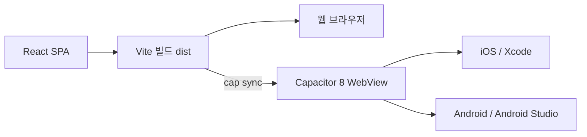

# React + Capacitor 하이브리드 앱 기술스택

2026-10-14 기준. `mobile/`의 React SPA를 Vite로 빌드해 웹에 배포하고, 같은 `dist/`를 Capacitor로 iOS·Android에 포함합니다.



## 선택한 스택

| 역할 | 선택 | 버전·기준 |
|---|---|---|
| 언어 | TypeScript strict | 5.9.x: openapi-typescript 7의 peer dependency에 맞춤 |
| 빌드 | Vite | 8.x, 신규 스캐폴딩은 create-vite 9 |
| UI | React + React DOM | 19.x |
| 라우팅 | React Router | 7.x, Declarative 모드, `react-router` import |
| 서버 상태 | TanStack Query | 5.x: 사용자 조회·캐시, 로그인 mutation |
| 전역 클라이언트 상태 | Zustand | 5.x |
| 스타일 | Tailwind CSS | 4.x + Mobile UI Design System MCP (`--ds-*` 토큰, `#7c4dff`, 라이트/다크/시스템 테마) |
| 네이티브 셸 | Capacitor | 8.x, `webDir: dist` |
| 시스템 바 | SystemBars | `@capacitor/core` 내장 |
| 앱 이벤트 | `@capacitor/app` | 8.x: Android backButton |
| Google 로그인 | `@capgo/capacitor-social-login` | Capacitor 8 호환, web/iOS/Android |
| 네이티브 JWT 저장 | `@aparajita/capacitor-secure-storage` | 8.x, iOS Keychain / Android Keystore |
| 테스트 | Vitest + React Testing Library | jsdom에서 React DOM 동작 검증 |
| API 타입 | openapi-typescript | `docs/openapi.json` → `src/lib/schema.d.ts` |
| OTA | Capgo 또는 Capawesome | 선택 후 연동, 현재 미설정 |

설치된 정확한 버전은 `mobile/package-lock.json`이 기준입니다. Ionic React는 앱 스타일 UI가 필요한 경우의 대안이며 현재 설치하지 않습니다. 도입 전 라우터 어댑터의 React Router 7 호환성을 확인합니다.

React Router의 SPA 구성은 [공식 Declarative 가이드](https://reactrouter.com/start/declarative/installation)를 따릅니다.

## 개발 환경

Vite 8 단독은 Node.js 20.19+ 또는 22.12+를 요구하지만, 이 프로젝트는 Capacitor 8도 사용하므로 **Node.js 22.12+**를 사용합니다. `.nvmrc`는 22입니다. [Vite 요구사항](https://v8.vite.dev/guide/), [Capacitor 8 변경사항](https://capacitorjs.com/docs/updating/8-0)

iOS는 macOS + Xcode 26+, iOS 15+를 대상으로 합니다. Capacitor 8에서 새 iOS 프로젝트는 SPM이 기본입니다. Android는 Android Studio Otter 2025.2.1+, SDK 36, minSdk 24가 기준입니다. 설치된 Gradle/AGP가 요구하는 JDK도 준비합니다. [Capacitor 환경 설정](https://capacitorjs.com/docs/getting-started/environment-setup)

## 기존 저장소에서 개발

```bash
cd mobile
npm ci
cp .env.example .env.local
# API URL과 Google OAuth 공개 클라이언트 ID 입력
npm run dev

npm run api:types
npm run typecheck
npm run lint
npm test
npm run build           # dist 생성
npm run sync            # build + cap sync
npm run ios             # Xcode 열기
npm run android         # Android Studio 열기
```

`ios/`와 `android/`는 네이티브 설정을 포함하므로 커밋합니다. `dist/`, 의존성, 서명 키, 로컬 환경변수는 커밋하지 않습니다. 웹 호스팅은 `/my` 등 직접 접속도 `index.html`로 rewrite하도록 설정합니다.

다른 빈 디렉터리에 새 앱을 만들 때만 아래 초기화 흐름을 사용합니다. 현재 저장소의 `mobile/` 위에 실행하지 않습니다.

```bash
npm create vite@9 my-app -- --template react-ts
cd my-app
npm install
npm i react-router@7 @tanstack/react-query@5 zustand@5 @capacitor/core@8 @capacitor/app@8
npm i -D @capacitor/cli@8 tailwindcss@4 @tailwindcss/vite@4
npx cap init             # 앱 이름·ID 입력, webDir을 dist로 지정
npm run build
npm i @capacitor/ios@8 @capacitor/android@8
npx cap add ios
npx cap add android
```

신규 앱에서는 Tailwind Vite 플러그인과 CSS import도 설정합니다. 이 저장소는 이미 구성되어 있습니다.

## Google 로그인과 API

- `.env.local`의 `VITE_API_URL`에 백엔드 URL, `VITE_GOOGLE_WEB_CLIENT_ID`와 `VITE_GOOGLE_IOS_CLIENT_ID`에 해당 OAuth 클라이언트 ID를 설정합니다. `VITE_*`는 번들에 노출되므로 비밀값을 넣지 않습니다.
- Google Cloud에서 웹 출처(개발은 `http://localhost:5173`, 운영은 실제 웹 URL)를 등록합니다. 웹 클라이언트의 승인된 리디렉션 URI에는 `http://localhost:5173/sign-in`과 운영 웹의 `/sign-in` URL도 등록합니다. Android OAuth 클라이언트에는 `com.reppley.template`과 개발·배포 서명의 SHA-1을 등록합니다.
- 네이티브 Google 콜백은 Android `MainActivity`와 iOS `AppDelegate`/`SceneDelegate`에 연결되어 있습니다.
- iOS OAuth 클라이언트의 번들 ID는 `com.reppley.template`입니다. `Info.plist`의 URL scheme을 해당 클라이언트 ID의 역순 값으로 맞춥니다. 현재 값은 기존 앱 설정에서 이전했습니다.
- `src/features/auth/google.ts`는 online 모드의 Google ID token을 받아 기존 `POST /auth/google` 계약으로 전달합니다. iOS server client ID와 백엔드 `GOOGLE_WEB_CLIENT_ID`도 같은 Web client ID를 사용합니다.
- JWT로 `GET /me`를 호출해 세션을 복원합니다. 거절된 토큰은 지우고 로그인 화면으로 돌아갑니다. 로그아웃은 토큰·Google 세션·Query 캐시를 비웁니다.
- 네이티브 토큰은 보안 저장소를 사용합니다. 웹은 **암호화되지 않은 sessionStorage**를 사용하며 탭이 닫히면 세션이 종료됩니다. HttpOnly 쿠키 방식으로 바꾸려면 백엔드 계약 변경이 필요합니다.
- 기존 Expo SecureStore의 저장값을 자동 이관하지 않으므로 기존 설치 사용자는 전환 후 다시 로그인해야 합니다.

플랫폼 설정은 [Google 로그인 가이드](https://capgo.app/docs/plugins/social-login/google/general/), [Android 설정](https://capgo.app/docs/plugins/social-login/google/android/), [iOS 설정](https://capgo.app/docs/plugins/social-login/google/ios/)를 따릅니다. 보안 저장소의 플랫폼 동작은 [플러그인 문서](https://github.com/aparajita/capacitor-secure-storage)를 참고하세요.

CORS는 Lambda Function URL의 SAM 설정 한 곳에서 관리합니다. Lambda URL CORS는 `http`/`https`(또는 `*`)만 허용해 iOS 출처 `capacitor://localhost`를 등록할 수 없으므로, 네이티브 앱은 `capacitor.config.ts`의 `CapacitorHttp`로 요청해 CORS를 거치지 않습니다. 기본 허용 출처는 `http://localhost:5173`(웹 개발), `https://localhost`(Android 웹뷰)입니다. 운영 웹 출처는 SAM의 `AllowedOrigins` 파라미터에 이 출처들과 함께 지정합니다. `server.hostname`/scheme 변경 시 CORS도 갱신합니다. 로컬 `uvicorn` 단독 실행에는 Function URL의 CORS 설정이 적용되지 않습니다. 웹 개발에서는 `VITE_API_URL=/api`로 두면 Vite가 `http://127.0.0.1:8000`으로 프록시합니다. 네이티브 및 운영 웹 빌드에는 실제 HTTPS 백엔드 URL을 지정합니다.

## 시스템 바와 네이티브 UX

- 네이티브 호출은 `Capacitor.isNativePlatform()`으로 분기합니다.
- SystemBars가 시스템 바 스타일을 정하고, 레이아웃 여백은 CSS가 처리합니다. `viewport-fit=cover`, `--safe-area-inset-*` 및 `env(safe-area-inset-*)` fallback을 적용합니다. Android edge-to-edge에서 상·하·좌·우 inset이 중복되지 않는지 확인합니다. [SystemBars 공식 문서](https://capacitorjs.com/docs/apis/system-bars)
- Android 뒤로가기는 열린 dialog를 먼저 닫고, 앱 내 이전 경로가 있으면 이동하며 루트에서는 종료합니다. 등록한 이벤트 리스너는 컴포넌트 해제 시 제거합니다.
- 버튼·탭에만 텍스트 선택·길게 누르기 메뉴 억제를 적용하고 입력·본문 복사와 포커스 표시를 유지합니다.
- 카메라·푸시 등은 기능 구현 시 8.x 호환 공식 플러그인과 권한 설정을 추가합니다.
